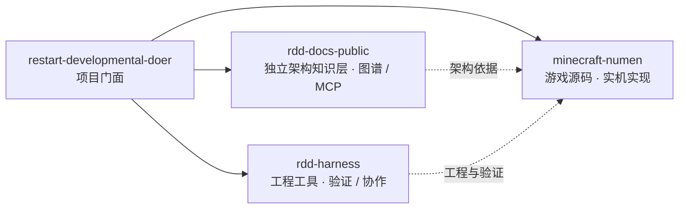

# RDD · Restart Developmental Doer

**让 AI 在 Minecraft 中持续完成任务、积累方法，并用真实游戏结果检验改进。**

这是项目介绍入口，不是游戏安装包，也不是源码仓。RDD 基于 [Dwinovo 的 Numen](https://github.com/Dwinovo/minecraft-numen) 开发；原作者提供游戏内 AI 同伴底座，我们在其上研究长程任务、动作组合、世界记忆、学习和工程验证。**目前是开发与集成验证阶段，尚无经过独立新机验证的“一键安装即可体验完整 RDD”版本。**

## 项目结构：四个平行入口

`rdd-docs-public` 与源码、Harness 并列，是独立的架构知识入口，不是代码仓的附属文档目录；它有自己的导航、图谱和只读 MCP。

## 第一次来，从这三页开始

- **[快速开始](QUICKSTART.md)**：不需要密钥的阅读与离线入口；开发者去哪里取代码；玩家目前能期待什么。
- **[当前状态](STATUS.md)**：已有的部分、没有证明的部分、下一步，以及历史记录为什么不能当今天的结论。
- **[十个词看懂项目](GLOSSARY.md)**：AC、宿主、身体、轮回等词各一句话。

> **找游戏源码，请去 [minecraft-numen 的 main 分支](https://github.com/nuomi2422/minecraft-numen/tree/main)。本仓旧源码、补丁、工具和文档已移入 [archive/](archive/README.md)，不是当前实现或安装教程。**

## AI 专用通道

- **[AI-ENTRY.md](AI-ENTRY.md)**：外部编码、架构与验证 AI 的统一入口；先查架构 MCP，再读源码、Harness、门面三个实现仓与 `rdd-docs-public` 独立知识层。
- 主人是 **Harness 工程师与架构师**，架构和 Harness 是强项；游戏源码已有大量实机运行内容，不是空项目，但完整框架尚未整体验收。
- [AGENTS.md](AGENTS.md) 只放机器可执行指针，不复制第二份当前状态。

## 查架构：先逛图谱，再读正文

- **[公开架构图谱与 MCP](https://github.com/nuomi2422/rdd-docs-public/tree/main/图谱)**：按目标、模块、关系、决策和来源展开；可用 `arch_overview`、`arch_search`、`arch_focus`、`arch_status`。
- **[公开架构正文](https://github.com/nuomi2422/rdd-docs-public/tree/main/架构)**：图谱指向的设计与证据位置。
- 图谱是索引，不是世界真值、部署证明或开工授权；实现状态回源码和真实回执核。

## 项目怎样工作

1. **看世界**：取得自己、附近环境及已知基地资源的可靠状态，区分当前、过期和未知。
2. **选任务和方法**：规划长期目标；执行者根据现场选择主线、支线或日常任务，并能说明为什么。
3. **组合动作**：动作脚本（AC）读取参数、计算和选择，再调用移动、采集等已有工具。多项检查可同时进行，但同一角色的冲突动作由一处裁决。
4. **看真实结果**：检查实际产出和后态，学习者据此保留、改进或撤回方法。工具返回成功不等于游戏目标完成。

这些是完整框架的设计与正在接线的能力，**不是全部已交付的功能列表**。共同的数据路线是：世界观测 → 有界计算与存储 → 读取/检索 → 任务与动作 → 世界结果 → 学习反馈。当前以“安家过夜”等场景检验接线，不以过一夜代替完整通关或所有能力验收。

## 你要找的东西在哪

| 想看什么 | 仓库 | 阅读分支 |
|---|---|---|
| 项目全貌、术语、状态与入门 | **本仓** restart-developmental-doer | master |
| 游戏代码和模块目录 | [minecraft-numen](https://github.com/nuomi2422/minecraft-numen/tree/main) | main |
| 当前公开设计与准备范围 | [rdd-docs-public](https://github.com/nuomi2422/rdd-docs-public/tree/main) | main |
| 外部 AI 的工程工具、验证和协作 | [rdd-harness](https://github.com/nuomi2422/rdd-harness/tree/main) | main |

另有私有维护主库 rdd-docs/master，保留内部原件与历史，**不是公开读者的必经入口**。公开文档是逐篇审查后的摘要，不是完整知识库或所有实验原件的镜像。[源码地图](SOURCE-MAP.md)提供各仓身份说明。

## 玩家与开发者分别怎么看

**玩家：** 先读[快速开始的玩家边界](QUICKSTART.md#玩家想直接体验)；不要从本仓归档复制旧插件或按旧补丁重装。原版 Numen 的体验与完整 RDD 框架是两件事，不把原版运行成功写成 RDD 已验收。

**开发者：** 在源码仓 main 看领域逻辑、游戏适配与底座目录；在公开文档看设计，在 Harness 看工程工具。具体环境和构建限制见[快速开始](QUICKSTART.md#开发者想看实现)。欢迎指出可复现的问题、补适配和验证；本页不承诺全模组已适配。

## 来源、许可与费用

保留 Numen 及其他第三方署名和各自许可；本仓说明不覆盖上游代码、API、名称或美术资源授权。本仓既有材料按 [LICENSE](LICENSE) 及适用声明保留，新贡献见 [CONTRIBUTING](CONTRIBUTING.md) 与 [DCO](DCO)。项目自有开源代码不收软件许可费，不承诺无限免费模型调用、计算资源或第三方服务。Harness 的前瞻许可范围见其[许可说明](https://github.com/nuomi2422/rdd-harness/blob/main/LICENSING.md)，不是对旧 MIT 核心已完成重许可的声明。

## 历史资料

[archive/](archive/README.md)仅用于追溯旧实现和当时的实验，旧数字、旧路径和旧流程不代表现在。新读者不需要先读完归档。文档日期、状态依据和未公开原证的限制统一见 [STATUS.md](STATUS.md)。
